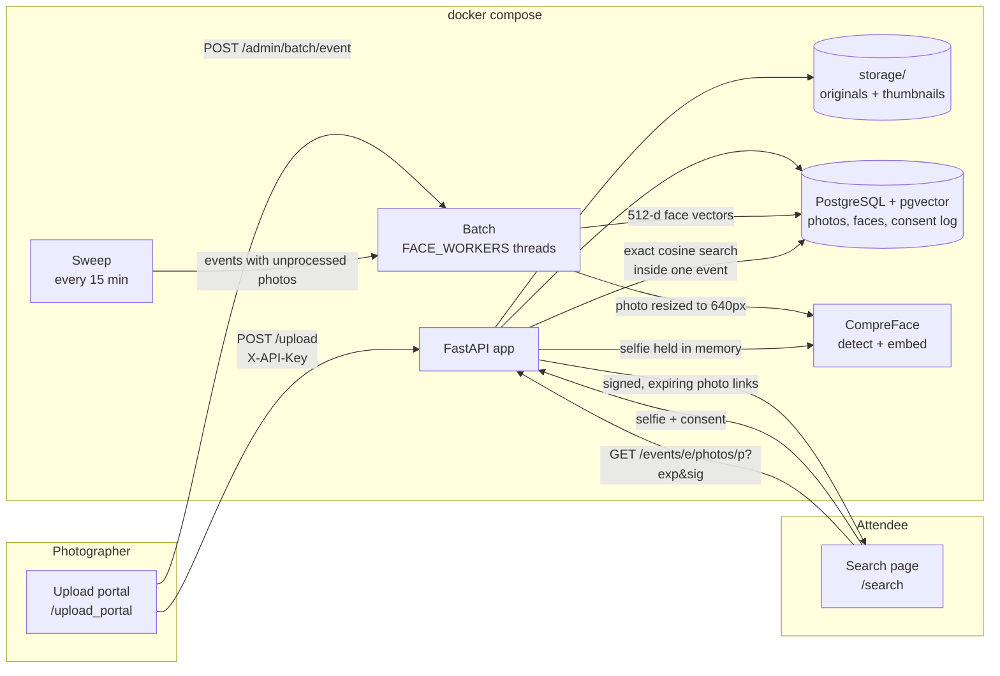

# Selfie Photo Search

Upload a selfie, get back the photos from an event that contain you.

Photographers upload an event's photos. A face-recognition service ([CompreFace](https://github.com/exadel-inc/CompreFace))
turns every face into a 512-number vector, PostgreSQL with [pgvector](https://github.com/pgvector/pgvector) stores
them, and a selfie is matched against the faces of one event by cosine similarity.

**Stack:** Python 3.11 · FastAPI · PostgreSQL + pgvector · CompreFace · Docker Compose

**Status:** works end to end and is covered by tests and benchmarks, but the match threshold has only been tested on
a small set of portraits, not on race-like photos (see [Results](#results) and [Known limitations](#known-limitations)).
Design reasoning is in [docs/DECISIONS.md](docs/DECISIONS.md).

## How it works



1. **Upload.** `POST /upload` validates the file (real JPEG/PNG, size and pixel limits), stores `<uuid>.<ext>` and a
   thumbnail under `storage/<event>/`, and records a row in `event_photos` with a path relative to `STORAGE_PATH`.
2. **Process.** When the portal finishes it calls `POST /admin/batch/{event}`. The batch claims the event, resizes each
   photo to 640 px, asks CompreFace for every face and its embedding, and stores one `face_embeddings` row per face.
   A sweep re-runs events that still have unprocessed photos.
3. **Search.** `POST /search/face` records consent, embeds the selfie (largest face), and finds, inside that event only,
   the photos whose best face has cosine similarity of at least `MIN_FACE_CONFIDENCE` (default 0.70). The selfie is
   never stored.
4. **View.** Results carry signed links that expire after an hour; photos are not served from a public folder.

## Quick start

Needs Docker Desktop (or Docker Engine + Compose V2) and Python 3.11 for the tests.

```bash
git clone <repo-url> selfie-photo-search
cd selfie-photo-search
cp .env.example .env            # PowerShell: Copy-Item .env.example .env
```

Generate three secrets and paste them into `.env` as `UPLOAD_API_KEY`, `ADMIN_API_KEY` and `PHOTO_URL_SECRET`
(run the line three times):

```bash
python -c "import secrets; print(secrets.token_urlsafe(32))"
```

Start the stack and load the schema:

```bash
docker compose up --build -d

# bash
docker exec -i media_ai_db psql -U media_user -d media_ai < db/schema.sql
# PowerShell
Get-Content db/schema.sql | docker exec -i media_ai_db psql -U media_user -d media_ai
```

Create the CompreFace key (the one manual step):

1. Open <http://localhost:8001>, create an account, create an application.
2. Add a **Face Detection** service (not Face Recognition: the code calls `/api/v1/detection/detect`).
3. Copy its API key into `.env` as `COMPREFACE_API_KEY=`.
4. `docker compose up -d --force-recreate api` so the app reads the new `.env`.

Check it:

```bash
curl http://localhost:8000/health                  # {"status":"ok"}
docker exec media_ai_db pg_isready -U media_user -d media_ai
```

| Page | URL |
|---|---|
| Photographer upload portal (asks for the upload key) | <http://localhost:8000/upload_portal> |
| Attendee selfie search | <http://localhost:8000/search> |
| API docs (Swagger) | <http://localhost:8000/docs> |

The two portals list two demo events (`00000000-0000-0000-0000-000000000001` and `...0002`). Any UUID works as an
event id.

### Try it from the command line

```bash
EVENT=00000000-0000-0000-0000-000000000001
curl -X POST http://localhost:8000/upload -H "X-API-Key: $UPLOAD_API_KEY" \
     -F "file=@photo.jpg" -F "event_id=$EVENT"
curl -X POST http://localhost:8000/admin/batch/$EVENT -H "X-API-Key: $ADMIN_API_KEY"
curl -H "X-API-Key: $ADMIN_API_KEY" http://localhost:8000/admin/events/$EVENT/stats
curl -X POST http://localhost:8000/search/face -F "selfie=@me.jpg" -F "event_id=$EVENT" -F "consent=true"
```

### Run the API outside Docker

```bash
docker compose up -d db compreface-ui          # database and CompreFace only
python -m venv venv && source venv/bin/activate    # PowerShell: .\venv\Scripts\Activate.ps1
pip install -r requirements.txt
uvicorn api.main:app --reload                  # reads .env: DB_HOST=localhost, COMPREFACE_URL=http://localhost:8001
```

## API overview

| Method and path | Who can call it | What it does |
|---|---|---|
| `GET /health` | anyone | liveness |
| `POST /upload`, `POST /upload/bulk` | `UPLOAD_API_KEY` or `ADMIN_API_KEY` | store photos for an event |
| `POST /admin/batch/{event_id}` | `ADMIN_API_KEY` | process an event's unprocessed photos (async) |
| `GET /admin/events/{event_id}/stats` | `ADMIN_API_KEY` | photo and face counts |
| `POST /search/face` | anyone; rate limited | selfie + `event_id` + `consent=true` → matching photos with signed links |
| `GET /events/{event_id}/photos/{photo_id}?size=thumb\|full&exp&sig` | signed link, or `ADMIN_API_KEY` | the image |
| `GET /upload_portal`, `GET /search` | anyone | the two pages |

Errors worth knowing: `401` bad or missing key, `503` a key or `PHOTO_URL_SECRET` is not configured or CompreFace is
unavailable, `413` too large, `415` not JPEG/PNG, `422` invalid id or no face in the selfie, `429` too many searches.

## Security model

* **API keys** in the `X-API-Key` header, compared in constant time. An empty key disables its routes (`503`) and logs a
  warning at startup. Static keys: no per-user accounts, no rotation.
* **Photos are private.** No static `/storage` mount. Each photo is served through an HMAC-SHA256 signed link
  (`PHOTO_URL_SECRET`) over event, photo, size and expiry; the route also checks the photo belongs to the event and
  that the stored path is inside `STORAGE_PATH`. Without the secret it fails closed.
* **Uploads** need a UUID event id, are capped while streaming, are verified as JPEG/PNG from their content with a pixel
  limit (decompression bombs), and are stored under a generated name, never the client's.
* **Selfies** are validated the same way, kept in memory plus a temp file outside storage that is always deleted, and
  never persisted. No selfie embedding is stored. A consent record (event, time, `consent_version`, no image) is written
  before the selfie is sent to CompreFace.
* **Abuse limits:** per-IP search rate limit; CORS is same-origin unless `CORS_ORIGINS` is set (never with credentials
  and `*`).

## Results

Full tables, method and caveats: [docs/benchmarks/RESULTS.md](docs/benchmarks/RESULTS.md). Run on one laptop, Docker with
small CPU caps (CompreFace at 1 CPU), so read them as relative numbers, not production capacity.

**Accuracy: small LFW test.** 10 people, 3 photos each in a 90-photo event, plus one person who is in none of the photos.
These are 250×250 portraits from the Labeled Faces in the Wild set, **not race photos**.

| Threshold | Photos of the right person returned (of 30) | Different-person matches (of 300 pairs) | Person not in the event |
|---|---|---|---|
| 0.75 (previous default) | 12 | 0 | no results |
| **0.70 (current default)** | **18** | **0** | **no results** |
| 0.50 (context only, not deployed) | 28 | 0 | highest similarity 0.451, below 0.50 |

Top-1 and top-5 were 10/10 at every threshold (the ranking does not depend on it). **The threshold still needs calibrating
on race-like photos:** ten people and 300 impostor pairs say nothing about distance, blur, hats or crowds, and a large
event has far more impostor faces than this test.

**Speed** (RBNR race photos and LFW photos together; RBNR is used for speed and face detection only, since it has no
identity labels). Face embedding is the bottleneck.

| | Result |
|---|---|
| Upload to all photos processed (90 photos, 177 faces) | 57.9 to 66.7 photos/min over four runs |
| CompreFace, 1 / 2 / 4 client workers | 1.53 / 1.21 / 1.11 calls/s: more workers did not help under a 1-CPU cap |
| Search, full HTTP (includes one CompreFace call) | p50 393 ms, p99 700 ms |
| Search query, 100,000 faces in 200 events (synthetic) | p50 8.2 ms, p99 51 ms; the previous query: 83 ms, 190 ms |
| Face detection | 59 of 60 RBNR photos had a face (146 faces); 30 of 30 LFW photos |

## OCR (disabled)

The project started as bib-number search: Tesseract OCR read the number on the runner's bib. On real race photos that proved
unreliable even with preprocessing, while face matching found photos OCR missed, so scope moved to selfie search.
The OCR code is **commented out, not deleted**, and every disabled place is marked `# OCR-DISABLED:` (or the HTML/JS
equivalent). The schema (`bib_detections`, `ocr_attempted_at`) is untouched. To see all sites: `grep -rn "OCR-DISABLED:" .`.
To restore it, see [docs/DECISIONS.md](docs/DECISIONS.md#1-why-ocr-is-disabled-and-how-to-restore-it). Commented-out code is
not tested.

## Configuration

Everything is in `.env` (template: [.env.example](.env.example)).

| Variable | Default | Meaning |
|---|---|---|
| `UPLOAD_API_KEY`, `ADMIN_API_KEY`, `PHOTO_URL_SECRET` | empty = routes return 503 | see Security |
| `COMPREFACE_URL`, `COMPREFACE_API_KEY` | `http://localhost:8001`, empty | CompreFace **Face Detection** service |
| `MIN_FACE_CONFIDENCE` | `0.70` | minimum cosine similarity to return a photo |
| `FACE_WORKERS` | `2` | parallel CompreFace calls in the batch |
| `SWEEP_INTERVAL_MINUTES`, `SWEEP_GRACE_MINUTES`, `BATCH_RUN_STALE_MINUTES` | `15`, `15`, `60` | recovery timings, see DECISIONS |
| `PHOTO_URL_TTL_SECONDS` | `3600` | lifetime of a signed link |
| `MAX_UPLOAD_MB`, `MAX_SELFIE_MB`, `MAX_IMAGE_PIXELS` | `25`, `5`, `64000000` | upload limits |
| `SEARCH_RATE_LIMIT_PER_MINUTE` | `10` | per client IP; `0` disables |
| `CONSENT_VERSION` | `v1` | stored with each consent record |
| `CORS_ORIGINS` | empty | comma-separated allowed origins; empty = same-origin only |
| `STORAGE_PATH`, `DB_*` | `./storage`, local Postgres | paths and database |

## Tests and benchmarks

```bash
pip install -r requirements-dev.txt
pytest                        # 153 tests (151 run, 2 skip without extras), about 25 s; the SQL tests need `docker compose up -d db`
FACE_TEST_PHOTOS=/path/to/photos pytest -m integration    # end to end against the running stack
FACE_TEST_PHOTOS=/path/to/photos python bench/benchmark.py --cleanup   # about 20 minutes, see bench/README.md
```

Tests that need SQL use a throwaway `media_ai_test` database in the same Postgres container and are skipped, with a
reason, if it is not running. CompreFace is always mocked in unit tests. Photos are never part of the repository.

## Known limitations

* **Threshold not calibrated on race-like photos.** 0.70 comes from a small LFW test.
* **Upload key cannot start processing.** The portal triggers `POST /admin/batch`, which needs the admin key. A
  photographer with only the upload key still uploads fine, but processing then waits for the sweep (up to about 30 minutes:
  `SWEEP_GRACE_MINUTES` plus `SWEEP_INTERVAL_MINUTES`). Giving photographers the admin key starts it at once but hands them
  admin rights. A narrower "start processing" permission is not implemented.
* **Rate limiter** is in-process: not shared across workers, and it trusts the socket address, so behind a proxy it needs
  real `X-Forwarded-For` handling.
* **Static API keys:** no per-user accounts, no rotation, no audit of who uploaded what.
* **No event registry:** an event is just a UUID. Anyone with the upload key can create one.
* **Retries have no cap.** A photo that makes CompreFace fail every time is retried on every sweep and adds an error row each
  time. CompreFace also returned occasional transient "connection reset" errors during benchmarking; those are retried.
* **Exact search cost grows with the faces in one event** (tested at about 500 faces per event); events with tens of
  thousands of faces were not tested and may need an approximate index (see DECISIONS).
* **Only the largest face in a selfie is searched.**
* **Benchmarks** use synthetic distractors for the index study and Windows/WSL2 with CompreFace capped at 1 CPU, so they show
  relative, not production, numbers.
* **Commented-out OCR code cannot be tested.**
* **Old database image:** `ankane/pgvector` (PostgreSQL 15.4, pgvector 0.5.1) is no longer maintained; a maintained pgvector
  image should replace it before real use.

## Wipe local data

Remove all photos, faces and consent records but keep the running stack:

```bash
docker exec media_ai_db psql -U media_user -d media_ai -c "TRUNCATE media_ai.search_results, media_ai.search_requests, media_ai.processing_errors, media_ai.face_embeddings, media_ai.bib_detections, media_ai.batch_runs, media_ai.event_photos CASCADE"
rm -rf storage/*              # PowerShell: Remove-Item -Recurse -Force storage\*
```

Remove everything this project created in Docker (database, CompreFace data and its keys; you must recreate the CompreFace
service and key afterwards):

```bash
docker compose down -v
```

## Project structure

```
api/
  main.py            app, CORS, scheduler, startup warnings
  security.py        API keys, signed URLs, upload validation, path safety, rate limiter
  models.py          response models
  routes/            upload.py · search.py · photos.py · admin.py
db/
  schema.sql         tables and indexes (safe to re-run)
  queries.py         the face-search SQL
  connection.py      connection pool
processing/
  face.py            CompreFace client (FaceServiceError / UnreadableImageError)
  batch.py           claim, process, sweep
  cleanup.py         purges selfies left by older versions
  ocr.py             disabled, kept intact
templates/           upload_portal.html · search.html
tests/               pytest suite (+ integration test)
bench/               benchmark.py and its README
docs/                DECISIONS.md · benchmarks/
```

## Data sources

The benchmarks use two public datasets; no photos are included in or redistributed by this repository.

* **LFW** (labelled portraits, accuracy): Huang, Ramesh, Berg, Learned-Miller, "Labeled Faces in the Wild: A Database for
  Studying Face Recognition in Unconstrained Environments", University of Massachusetts Amherst Technical Report 07-49,
  October 2007. The canonical site (<https://vis-www.cs.umass.edu/lfw/>) did not resolve when the benchmarks were run, so the
  original, unresized `lfw_funneled` JPEGs came from the mirror that scikit-learn's `fetch_lfw_people` downloads from
  (figshare).
* **RBNR** (race photos, speed and face detection only): Ben-Ami, Basha, Avidan, "Racing Bib Numbers Recognition", BMVC 2012
  (citation from memory; verify before publishing); downloaded from
  <https://people.csail.mit.edu/talidekel/Data/RBNR/RBNR_Datasets.zip>.
